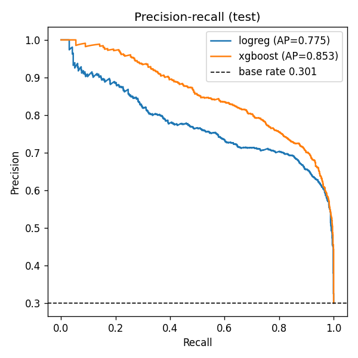
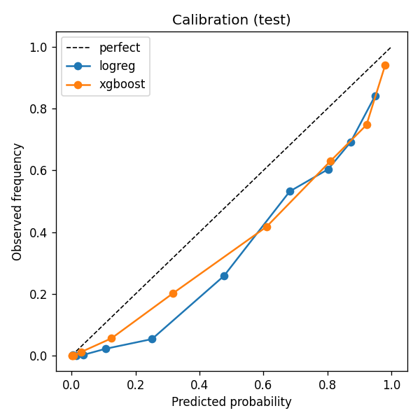

# AgniDrishti — weekly wildfire risk for Uttarakhand

AgniDrishti ("fire sight") predicts, for every 0.25° grid cell in Uttarakhand, India, the
probability that a satellite fire hotspot will be detected in that cell during the next 7 days.
Predictions are shown on an interactive web map with a per-cell SHAP explanation.

## Problem statement

Uttarakhand's forests (chir pine, oak, mixed broadleaf) burn every pre-monsoon season
(Feb–June), with peaks in April–May. Forest departments must place limited crews and
watchers weeks in advance. A weekly, cell-level risk score built from openly available weather,
terrain and fire-history data can help prioritise where to look. This is a course prototype,
**not** an operational warning system.

## Data sources and licenses

| Source | What | License / terms |
|---|---|---|
| [NASA FIRMS](https://firms.modaps.eosdis.nasa.gov/) VIIRS S-NPP 375 m, standard processing (`VIIRS_SNPP_SP`) | Active fire detections 2015–2024 | NASA open data; cite *NASA FIRMS, doi:10.5067/FIRMS/VIIRS/VNP14IMGT_NRT.002*. Needs a free MAP_KEY. |
| [Open-Meteo Historical Weather API](https://open-meteo.com/en/docs/historical-weather-api) | Daily tmax, tmin, mean RH, max wind, precipitation (ERA5 / ERA5-Land reanalysis) | CC BY 4.0 (Open-Meteo); ERA5 © Copernicus Climate Change Service |
| [Open-Meteo Elevation API](https://open-meteo.com/en/docs/elevation-api) | Elevation (Copernicus DEM GLO-90) | CC BY 4.0; Copernicus DEM © DLR/Airbus, free licence |
| [GADM 4.1](https://gadm.org/) level-1 | Uttarakhand state boundary | Free for academic / non-commercial use; no redistribution (so it is downloaded, not committed) |

All raw responses are cached in `data/raw/` (gitignored), so reruns do not re-download.

## Method

1. **Grid** (`grid.py`): 0.25° cells over the bounding box 77.5–81.25°E, 28.5–31.5°N; a cell is
   kept if its centroid lies inside the GADM polygon (**79 cells**). `cell_id = r{lat_idx}c{lon_idx}`
   uses the global 0.25° index, so IDs are stable.
2. **Ingest** (`ingest/`): FIRMS in 5-day area requests; low-confidence (`l`) detections are
   dropped, the rest clipped to the state polygon and assigned to cells. Weather per cell centroid
   per year. Terrain: 11 × 11 elevation samples per cell → mean elevation and mean slope.
3. **Labels** (`labels.py`): forecast dates are Mondays (ISO week starts). `y = 1` if any kept
   detection falls in `[week_start, week_start + 7 days)`.
4. **Features** (`features.py`), using only data **strictly before** `week_start`:
   - 7- and 14-day rolling means of tmax, RH, wind and precipitation
   - days since the last day with ≥ 2 mm rain (capped at 365)
   - `fwi_7d`: a simplified fire weather index — the Fosberg FWI (from temperature, RH, wind)
     multiplied by `exp(-0.1 × rain in the last 3 days)`, averaged over 7 days
   - `elev_mean`, `slope_mean`
   - hotspot counts in the cell over the previous 4, 12 and 52 weeks; days since the last hotspot
   - week of year as sine and cosine
5. **Split** (`train.py`): by time only — train 2015–2021, validate 2022–2023, test 2024.
6. **Models**: logistic regression (`class_weight="balanced"`, median imputation, scaling) as a
   baseline; XGBoost with `scale_pos_weight = negatives / positives`, tuned with a 16-point grid
   (depth, learning rate, trees, min child weight) on validation PR-AUC.
7. **Evaluation** (`evaluate.py`): PR-AUC, ROC-AUC, Brier score, PR curve and calibration curve
   on the 2024 test set → `reports/`.
8. **Explanations** (`explain.py`): SHAP `TreeExplainer` on XGBoost; the top 5 signed
   contributions (log-odds) per cell and date are stored for the API.
9. **Serving**: FastAPI reads the precomputed predictions table (validation + test weeks); the
   model is never run per request.

## Results (2024 test set)

RESULTS_TABLE

 

## Limitations

- **FIRMS detects heat, not cause.** Controlled burns, crop-residue burning and industrial heat
  sources count as "fire"; there is no distinction between wildfire and managed fire.
- **Detection gaps.** VIIRS passes ~twice a day; cloud, smoke and dense canopy hide fires, and
  small or short fires are missed, so negatives are noisy.
- **Coarse weather.** Open-Meteo/ERA5 is ~0.25° (about 25–28 km); valley/ridge microclimates
  and local winds are not resolved. Weather is taken at the cell centroid only.
- **Coarse terrain.** Slope comes from 11 × 11 samples (~2.3 km apart) per cell, so it
  understates real slopes.
- **Simplified FWI.** `fwi_7d` is not the Canadian FWI system; it has no fuel-moisture memory
  beyond the rain damping.
- **Short history at the start.** For 2015 the 52-week hotspot counts only see data from
  January 2015 onward.
- **No fuel or human factors.** Forest type, fuel load, roads, population and burning
  practices are not modelled.
- **Calibration.** Class weighting raises probabilities; read them as relative risk unless the
  calibration plot shows otherwise.
- **Hindcast only.** The app serves 2022–2024 hindcasts; it does not ingest live forecasts.

## How to reproduce

Requires Python 3.11+ and internet access.

```bash
python -m venv .venv
.venv\Scripts\activate          # Linux/macOS: source .venv/bin/activate
pip install -e ".[dev]"
copy .env.example .env          # then put your key in .env: FIRMS_MAP_KEY=...
```

Get a free FIRMS MAP_KEY at <https://firms.modaps.eosdis.nasa.gov/api/map_key/>.

| Step | Command | Output |
|---|---|---|
| Ingest everything | `python -m agnidrishti.ingest` | `data/processed/{grid,terrain,weather,firms}.parquet` |
| One ingest step | `python -m agnidrishti.ingest --only weather` | (`grid`, `terrain`, `weather`, `firms`) |
| Features + labels | `python -m agnidrishti.features` | `data/processed/dataset.parquet` |
| Train, evaluate, explain | `python -m agnidrishti.train` | `models/xgb_v1.joblib` + `.json`, `reports/`, predictions + SHAP tables |
| Web app | `uvicorn agnidrishti.api.main:app` | <http://127.0.0.1:8000> |
| Tests | `pytest` | |
| Lint | `ruff check .` | |

**Weather download time.** Open-Meteo's free tier weights a one-year request as ~26 calls and
allows 10,000 calls per day, so 79 cells × 10 years (~20k weighted calls) takes **about two
days**. The downloader waits out minute/hour limits automatically and stops with a clear message
on the daily limit; rerun the same command the next day and cached years are skipped.

## API

| Endpoint | Description |
|---|---|
| `GET /api/health` | status, number of cells and dates |
| `GET /api/dates` | available prediction dates (Mondays) |
| `GET /api/risk?date=YYYY-MM-DD` | GeoJSON FeatureCollection, properties `cell_id`, `prob` |
| `GET /api/cells/{cell_id}/history[?date=]` | last 12 weeks of features, labels and probabilities |
| `GET /api/cells/{cell_id}/explain?date=` | SHAP top-5 contributions |
| `GET /api/model` | model version, features, window, hyperparameters, metrics |
| `GET /` | the web map |

Interactive docs: <http://127.0.0.1:8000/docs>.

## Project layout

```
agnidrishti/   config, grid, ingest/, labels, features, train, evaluate, explain, api/
web/           index.html, app.js, style.css (Leaflet + Chart.js, no build step)
tests/         leakage, labels, temporal split, API
models/        xgb_v1.joblib + xgb_v1.json (sidecar)
reports/       metrics.json, pr_curve_test.png, calibration_test.png
data/          raw/ and processed/ (gitignored)
```
